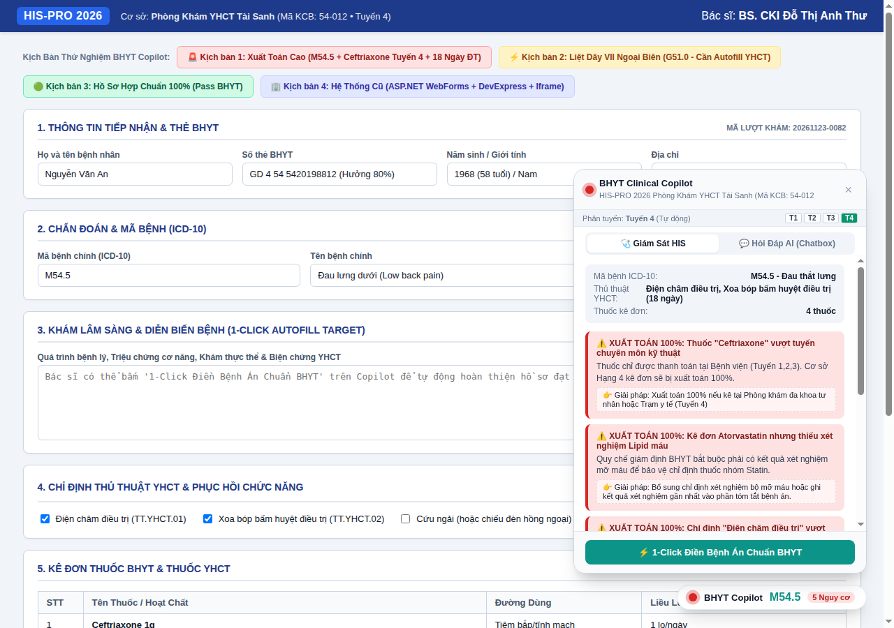
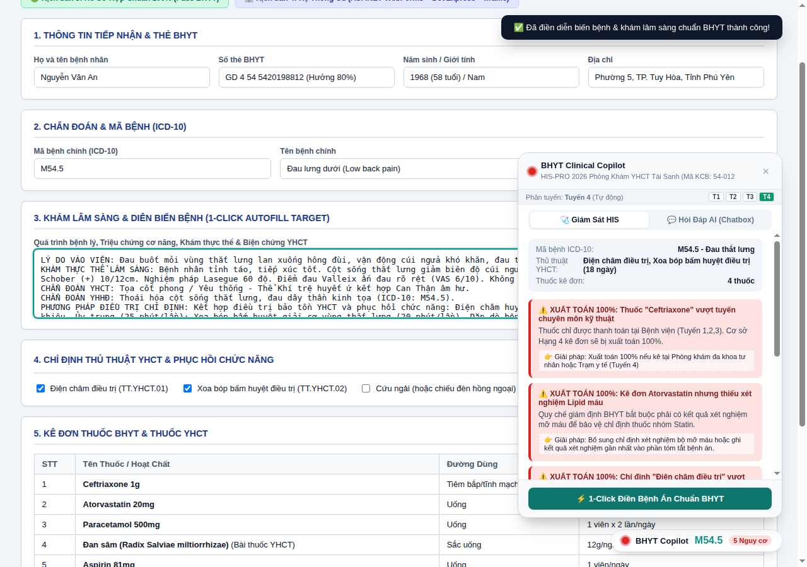
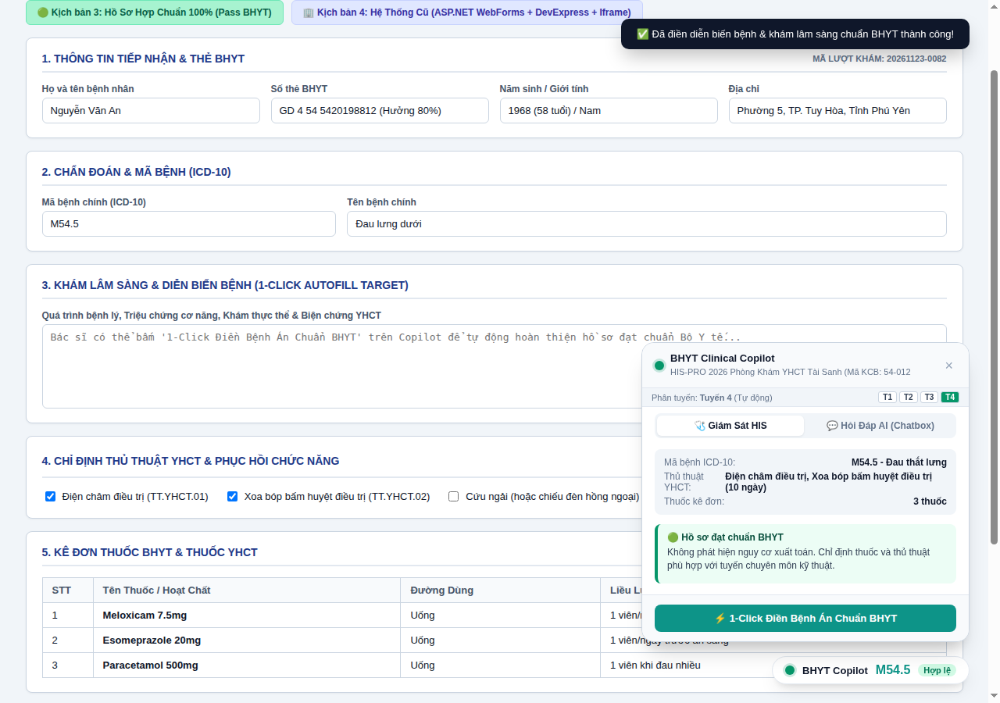
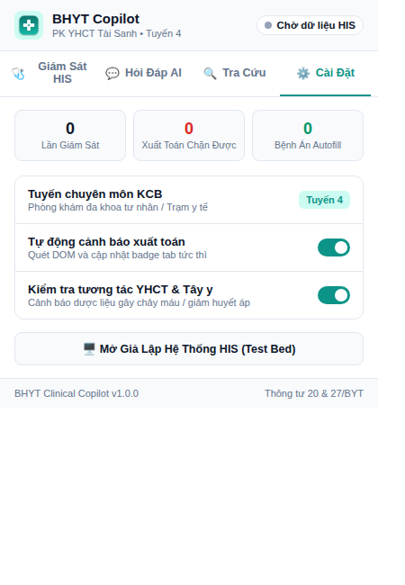
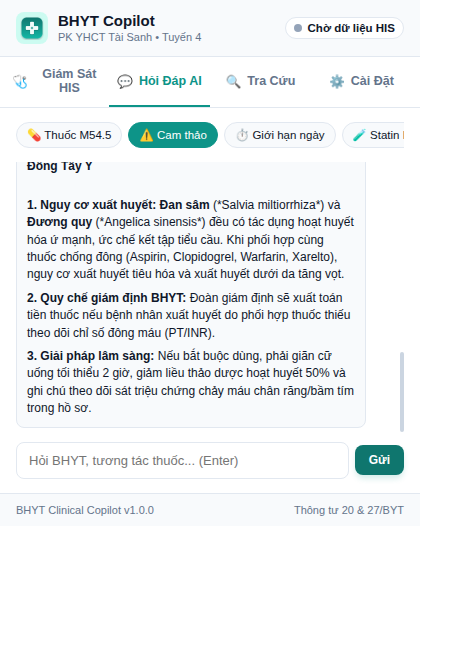
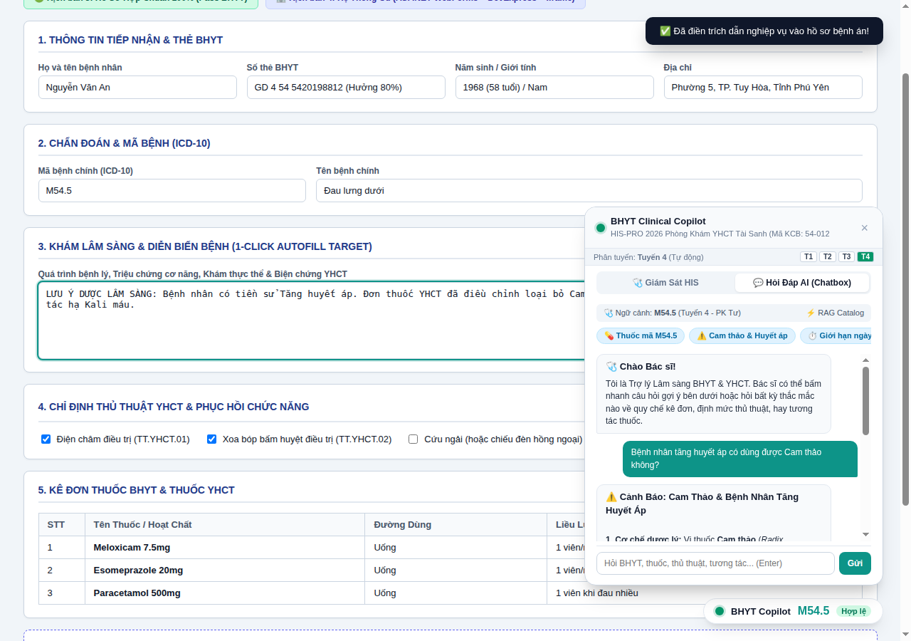

# TaiSanh BHYT Clinical Copilot & Xuất Toán Audit Engine

<p align="center">
  <strong>Enterprise-Grade Clinical AI Assistant, Zero-Rejection BHYT Guardian & In-Browser Copilot for Vietnamese Healthcare</strong>
</p>

<p align="center">
  <a href="README.vi.md">🇻🇳 <strong>Tiếng Việt (Vietnamese Documentation)</strong></a> &nbsp;|&nbsp; 
  <a href="README.md">🇬🇧 <strong>English (Active)</strong></a>
</p>

<p align="center">
  
  
  
  
  
  
  
  
  
  
</p>

---

## 📑 Table of Contents

1. [Executive Summary](#-executive-summary)
2. [Key Clinical & Financial Pain Points Solved](#-key-clinical--financial-pain-points-solved)
3. [System Architecture](#-system-architecture)
4. [Live Visual Showcase](#-live-visual-showcase)
5. [Core Functional Modules](#-core-functional-modules)
6. [Model Context Protocol (MCP) Guide](#-model-context-protocol-mcp-guide)
7. [Installation & Quick Start](#-installation--quick-start)
8. [Chrome Extension Deployment](#-chrome-extension-deployment)
9. [CLI Command Reference](#-cli-command-reference)
10. [REST API Documentation](#-rest-api-documentation)
11. [Regulatory & Legal Framework](#-regulatory--legal-framework)
12. [Verification & Automated Test Suite](#-verification--automated-test-suite)
13. [Directory Layout](#-directory-layout)
14. [Contributing & License](#-contributing--license)

---

## 🌟 Executive Summary

**TaiSanh BHYT Clinical Copilot** is a domain-specialized, enterprise-grade AI system developed to eliminate **Health Insurance Rejections (Xuất toán BHYT)**, enforce **strict clinical coding standards**, safeguard **Eastern–Western herb-drug interactions (YHCT & Tân Dược)**, and inject **1-click automated clinical documentation** into legacy Hospital Information Systems (HIS/EMR) across Vietnam.

Unlike generic LLM scribes that struggle with closed hospital networks and local regulatory nuances, TaiSanh BHYT Copilot operates directly inside the physician's browser via a **Chrome Extension Manifest V3**, backed by a local **FastAPI / Model Context Protocol (MCP)** service and an ultra-fast **SQLite FTS5 knowledge catalog** containing **15,827 official Vietnamese ICD-10 codes**, Western drug lists (Circular 20/2022/TT-BYT), TCM herb catalogs (Circular 27/2020/TT-BYT), and procedural duration ceilings (Circular 13/2019/TT-BYT).

```
   ┌────────────────────────────────────────────────────────────────────────┐
   │                     BHYT REJECTION PREVENTION RADAR                    │
   │  [!] Tier 4 Rejection: Ceftriaxone 1g injection forbidden at clinics.  │
   │  [!] Missing Subcode: M54 requires 4-character code -> M54.5.          │
   │  [!] Missing Lab Test: Statin (E78) requires Lipid panel within 90d.   │
   │  [!] Herb-Drug Risk: Dan Shen + Aspirin raises internal bleed risk.    │
   │  [+] Recommendation: Meloxicam 7.5mg + Electroacupuncture <= 15 days.  │
   └────────────────────────────────────────────────────────────────────────┘
```

---

## 🩺 Key Clinical & Financial Pain Points Solved

### 1. Zero BHYT Rejection Guarantee (Chống Xuất Toán Triệt Để)
Vietnamese Social Security (BHXH) automatically reviews electronic hospital claims through the National BHYT Portal. Prescribing antibiotics above the facility's licensed technical tier, using incomplete 3-character ICD-10 codes, or prescribing Statins without a recent lipid panel results in **100% financial claim forfeiture**, penalizing physician salaries and clinic revenue. TaiSanh Copilot flags these violations **in real time before submission**.

### 2. Traditional Medicine (YHCT) & Western Herb-Drug Interaction Guard
Vietnam is one of the few nations where integrative Eastern-Western medicine is widely reimbursed by social health insurance. However, conventional medical AI lacks knowledge of Vietnamese botanical pharmacognosy. TaiSanh Copilot intercepts hazardous interactions—such as **Licorice (*Cam thảo*)** causing pseudo-hyperaldosteronism, severe hypokalemia, and blunting antihypertensive drugs, or **Salvia (*Đan sâm*) / Angelica (*Đương quy*)** potentiating antiplatelet/anticoagulant drugs (Aspirin, Warfarin, Clopidogrel) leading to gastrointestinal hemorrhages.

### 3. Non-Invasive Legacy HIS/EMR Integration (Zero-API DOM Injection)
Major Vietnamese HIS solutions (VNPT-HIS, Viettel Solutions, Medisoft, FPT Healthcare) operate in closed environments with months-long API authorization cycles. TaiSanh Copilot bypasses the API roadblock through a modern **In-Browser Content Script**, reading form inputs and injecting compliant physical examination findings and clinical notes via **1-Click Autofill**.

### 4. Continuous Regulatory Auto-Update Watchdog
Ministry of Health circulars and official joint-use lists undergo frequent revisions. The embedded Auto-Update Engine checks checksums, downloads incremental updates, verifies schema integrity, and applies atomic migrations to local databases without service downtime.

---

## 🏛️ System Architecture

TaiSanh BHYT Clinical Copilot employs a decoupled 3-tier hybrid architecture:

```
┌───────────────────────────────────────────────────────────────────────────────────────────────────┐
│                                   IN-BROWSER CLIENT TIER                                          │
│                                                                                                   │
│   ┌───────────────────────────────────────────────────────────────────────────────────────────┐   │
│   │                          Hospital HIS / EMR Web Portal (DOM Interface)                     │   │
│   │               [ ICD-10 Input ]       [ Drug Prescriptions ]      [ Procedural Orders ]    │   │
│   └──────────────────────┬─────────────────────────┬───────────────────────────┬──────────────┘   │
│                          │ Input / Change Events   │ Real-time Monitoring      │ 1-Click Paste    │
│                          ▼                         ▼                           ▲                  │
│   ┌────────────────────────────────────────────────────────────────────────────┴──────────────┐   │
│   │                 Chrome Extension Manifest V3 (Content Script & Floating Dock)              │   │
│   │  • Floating Status Badge (Zero/High Risk Counter)  • Injected Red/Amber Warning Badges    │   │
│   │  • 1-Click Clinical Note Auto-Paste Engine         • Real-Time Interactive Audit Modal    │   │
│   └──────────────────────┬─────────────────────────────────────────────────────┬──────────────┘   │
│                          │ Message Passing                                     │ Chrome Storage   │
│                          ▼                                                     ▼                  │
│   ┌──────────────────────────────────────────────────────┐   ┌────────────────────────────────┐   │
│   │           Extension Service Worker / Popup           │   │ Embedded Offline Catalog JSON  │   │
│   │  • Local Rule Cache    • Background Alarms & Sync    │   │ 15,827 ICD, Drugs, TCM, Rules  │   │
│   └──────────────────────┬───────────────────────────────┘   └────────────────────────────────┘   │
└──────────────────────────┼────────────────────────────────────────────────────────────────────────┘
                           │ HTTP / REST / JSON-RPC
                           ▼
┌───────────────────────────────────────────────────────────────────────────────────────────────────┐
│                                  BACKEND & MCP ENGINE TIER                                        │
│                                                                                                   │
│   ┌──────────────────────────────────────────────────────┐   ┌────────────────────────────────┐   │
│   │            FastAPI REST Server (:8123)               │   │      Stdio MCP Server          │   │
│   │  • POST /api/validate       • POST /api/suggest-note │   │  • Tools: validate_prescription│   │
│   │  • GET  /api/search-icd     • POST /api/chat (Q&A)   │   │  • Tools: search_icd10         │   │
│   │  • POST /api/sync-data      • GET  /api/health       │   │  • Tools: ask_clinical_copilot │   │
│   └──────────────────────┬───────────────────────────────┘   └────────────────┬───────────────┘   │
│                          │                                                    │                   │
│                          └───────────────────────┬────────────────────────────┘                   │
│                                                  ▼                                                │
│   ┌───────────────────────────────────────────────────────────────────────────────────────────┐   │
│   │                        Core Audit & Validation Engine (server.py)                         │   │
│   │  • Hospital Tier Checker (Level 1-4)                 • ICD Subcode & Primary Eligibility  │   │
│   │  • TCM Herb-Drug Cross Interaction Detector          • Procedure Day Caps (TT13/2019)     │   │
│   │  • Required Paraclinical Evidence Matrix             • Clinical SOAP Note Synthesizer     │   │
│   └──────────────────────────────────────────────┬────────────────────────────────────────────┘   │
└──────────────────────────────────────────────────┼────────────────────────────────────────────────┘
                                                   │ SQLite Connection & FTS5 Queries
                                                   ▼
┌───────────────────────────────────────────────────────────────────────────────────────────────────┐
│                                DATA STORAGE & AUTO-SYNC TIER                                      │
│                                                                                                   │
│   ┌───────────────────────────────────────────────────────────────────────────────────────────┐   │
│   │                     SQLite Catalog Database (data/bhyt_catalog.db)                        │   │
│   │  • icd10 (15,827 rows + FTS5 full-text index)        • thuoc_bhyt (TT20/2022 Western drugs│   │
│   │  • thuoc_yhct (TT27/2020 TCM herbs & actions)        • thu_thuat_bhyt (TT13 procedures)   │   │
│   │  • xuat_toan_rules (22 core rejection rules)         • yhct_icd10_mapping (QĐ 4443/QĐ-BYT)│   │
│   └──────────────────────────────────────────────▲────────────────────────────────────────────┘   │
│                                                  │ Delta Updates & Verification                   │
│   ┌──────────────────────────────────────────────┴────────────────────────────────────────────┐   │
│   │                 Auto-Update Watchdog & Synchronization Pipeline (updater.py)              │   │
│   │  • Checksum Verification (SHA-256)                   • Atomic Snapshot Backups            │   │
│   │  • MoH / BHXH Open Data Scrapers                     • Scheduled Cron Execution           │   │
│   └───────────────────────────────────────────────────────────────────────────────────────────┘   │
└───────────────────────────────────────────────────────────────────────────────────────────────────┘
```

---

## 📸 Live Visual Showcase

### 1. In-Browser Floating Audit Card on HIS Portal
*The copilot detects an illegal Level 4 antibiotic prescription (Ceftriaxone 1g injection), missing mandatory ICD-10 subcode, procedure duration overflow, and high-risk Herb-Drug interaction:*



---

### 2. 1-Click Clinical Note & Physical Examination Autofill
*Generating compliant clinical rationale, TCM syndrome differentiation, and diagnostic justification directly into the HIS clinical notes field:*



---

### 3. Clean Compliant Record (Zero Rejection Verified)
*When all prescriptions, subcodes, and procedures match Ministry of Health regulations, the copilot displays a green compliant status:*



---

### 4. Extension Popup & Fast Offline Catalog Search
*Instant FTS5 full-text search across 15,827 ICD-10 codes and TCM herbs with regulatory badges:*



---

### 5. AI Clinical Q&A Chatbox on Extension Popup
*Interactive clinical consultation answering herb-drug interactions (Cam Thảo, Đan Sâm), prescribing tiers, and 1-click clipboard / HIS snippet insertion:*



---

### 6. In-Browser Floating Dock AI Clinical Chatbox on HIS
*Physicians can consult the AI copilot directly inside their hospital EMR tab and click "Điền Vào Bệnh Án" to inject clinical notes without leaving the page:*



---

## ⚡ Core Functional Modules

| Module | Location | Primary Responsibilities |
| :--- | :--- | :--- |
| **BHYT Audit Engine** | `mcp_server/server.py` | 22+ clinical rejection validation rules, tier compliance, duration caps, lab requirements. |
| **Clinical Q&A Copilot** | `mcp_server/server.py` | Real-time RAG assistant providing clinical pharmacology advice and BHYT circular references. |
| **FastAPI REST Service** | `mcp_server/api.py` | High-throughput async REST API serving browser extensions and hospital microservices. |
| **MCP Stdio Server** | `mcp_server/mcp_stdio.py` | JSON-RPC 2.0 stdio engine for Claude Desktop, Cursor, Hermes Agent, and IDE copilots. |
| **Chrome Extension V3** | `extension/` | In-browser floating dock, content script DOM interceptors, offline SQLite mirror. |
| **SQLite Catalog** | `data/bhyt_catalog.db` | 15,827 ICD-10 codes, FTS5 virtual tables, TT20 Western drugs, TT27 TCM herbs. |
| **Data Engine CLI** | `data_engine/cli.py` | Terminal utility for quick audits, drug lookups, catalog health inspections. |
| **Auto-Update Engine** | `data_engine/updater.py` | Automated schema migrations, SHA-256 integrity verifications, delta downloads. |

---

## 🤖 Model Context Protocol (MCP) Guide

TaiSanh BHYT Copilot implements the standardized **Model Context Protocol (MCP)** specification (version `2024-11-05`), allowing LLMs like Anthropic Claude, Cursor AI, and Hermes Agent to inspect prescriptions and clinical guidelines deterministically.

### 1. Claude Desktop Configuration
Add the server entry to your `claude_desktop_config.json`:

- **macOS**: `~/Library/Application Support/Claude/claude_desktop_config.json`
- **Windows**: `%APPDATA%\Claude\claude_desktop_config.json`
- **Linux**: `~/.config/Claude/claude_desktop_config.json`

```json
{
  "mcpServers": {
    "taisan-bhyt-copilot": {
      "command": "python3",
      "args": ["-m", "mcp_server.mcp_stdio"],
      "cwd": "/root/taisan-bhyt-copilot"
    }
  }
}
```

### 2. Cursor IDE Integration
In your project directory or user profile, edit `.cursor/mcp.json`:

```json
{
  "mcpServers": {
    "bhyt-copilot": {
      "command": "python3",
      "args": ["/root/taisan-bhyt-copilot/mcp_server/mcp_stdio.py"]
    }
  }
}
```

### 3. Exposed MCP Tools Specification

#### `validate_prescription`
Validates outpatient and inpatient prescriptions against Vietnamese health insurance regulations.
- **Inputs**:
  - `icd_code` *(string, required)*: Primary ICD-10 diagnosis code (e.g. `"M54.5"`, `"E11.9"`).
  - `drugs` *(array of strings)*: Drug names and dosage forms (e.g. `["Ceftriaxone 1g", "Paracetamol 500mg"]`).
  - `hospital_level` *(string, default "4")*: Technical tier (`"1"` = Central, `"2"` = Provincial, `"3"` = District, `"4"` = Private Clinic / Commune Station).
  - `procedures` *(array of strings)*: Indicated physical therapy or TCM procedures (e.g. `["Điện châm điều trị"]`).
  - `lab_tests` *(array of strings)*: Available laboratory tests (e.g. `["Lipid máu", "Glucose"]`).
  - `procedure_days` *(integer, default 1)*: Indicated treatment round duration in days.
- **Output**: JSON payload with `status` (`PASS`, `FAIL_RISK`, `REJECT`), `high_risk_count`, `warnings`, and actionable remedies.

#### `search_icd10`
Full-text search over 15,827 official Vietnamese ICD-10 disease codes.
- **Inputs**: `keyword` *(string)*, `limit` *(integer, default 10)*.
- **Output**: List of matched ICD-10 entries with chapter, block, and BHYT constraint flags (`must_use_subcode`, `not_allowed_primary`).

#### `check_herb_drug_interaction`
Detects hazardous clinical interactions between traditional botanical medicines and Western pharmaceuticals.
- **Inputs**: `tcm_herbs` *(array of strings)*, `western_drugs` *(array of strings)*.
- **Output**: Detailed warnings including mechanism of interaction, pharmacological risks, and safe alternatives.

#### `suggest_clinical_note`
Synthesizes compliant SOAP clinical notes, physical examination findings, and TCM differentiation.
- **Inputs**: `icd_code` *(string)*, `procedures` *(array of strings)*, `symptoms` *(optional string)*.
- **Output**: Formatted clinical documentation ready for 1-click insertion into the EMR.

#### `ask_clinical_copilot`
Interactive RAG knowledge engine for real-time BHYT circular guidance, technical tier limits, and drug guidelines.
- **Inputs**: `query` *(string)*, `hospital_level` *(string, default "4")*.
- **Output**: Contextual guidance, citations to official circulars, and recommended documentation snippets.

---

## 🚀 Installation & Quick Start

### 1. Prerequisites
- Linux, macOS, or Windows WSL2
- Python `>= 3.10`
- SQLite `>= 3.35` (with FTS5 support)
- Modern Chrome/Edge/Brave browser (for extension)

### 2. Clone and Setup Environment
```bash
# Clone the repository
git clone https://github.com/phongkhamtaisanh/taisan-bhyt-copilot.git
cd taisan-bhyt-copilot

# Optional: Create and activate virtual environment
python3 -m venv .venv
source .venv/bin/activate

# Install dependencies
pip install -r requirements.txt
```

### 3. Verify SQLite Knowledge Database
```bash
# Verify catalog status
python3 data_engine/cli.py status
```
*Expected Output:*
```
======================================================================
  TAI SANH BHYT CLINICAL COPILOT & XUẤT TOÁN VALIDATOR
======================================================================
Database Location : /root/taisan-bhyt-copilot/data/bhyt_catalog.db
Metadata Version  : 1.0.0
Last Synchronized : 2026-11-23T20:41:26
Sync Checksum     : 7a9e403d1fb...

--- RECORD COUNTS ---
• ICD-10 Disease Codes      : 15,827
• BHYT Western Drugs (TT20) : 378
• TCM Herbs & Formulas (TT27): 210
• BHYT Procedures (TT13)    : 10
• Core Xuat Toan Rules      : 22
======================================================================
```

### 4. Launch Backend Services
```bash
# Launch FastAPI REST Server (serves Extension & Webhooks)
python3 -m uvicorn mcp_server.api:app --host 127.0.0.1 --port 8123

# In another terminal: Test MCP Server over Stdio
python3 -m mcp_server.mcp_stdio
```

---

## 🧩 Chrome Extension Deployment

The Chrome Extension runs natively in any Chromium-based browser (Chrome, Edge, Brave, Opera):

1. Open your browser and navigate to `chrome://extensions/`.
2. Toggle **Developer mode** on (top-right corner).
3. Click **Load unpacked** (top-left button).
4. Select the `extension/` directory from this repository:
   ```
   /root/taisan-bhyt-copilot/extension
   ```
5. Pin the **BHYT Copilot** icon to your toolbar.
6. Open any hospital web portal or test with the built-in offline test bed:
   ```bash
   # Open the local test bed in your browser:
   file:///root/taisan-bhyt-copilot/extension/test_bed.html
   ```

---

## 💻 CLI Command Reference

The built-in CLI provides immediate operational access to the rules engine:

```bash
# 1. Search ICD-10 codes with instant full-text search
python3 data_engine/cli.py search icd "thoát vị đĩa đệm"

# 2. Search Western drugs and technical tier authorizations
python3 data_engine/cli.py search drug "ceftriaxone"

# 3. Search TCM herbs and view adverse interaction alerts
python3 data_engine/cli.py search herb "đan sâm"

# 4. Perform an end-to-end BHYT prescription audit
python3 data_engine/cli.py audit \
  --icd M54.5 \
  --drugs "Paracetamol 500mg, Ceftriaxone 1g" \
  --procedures "Điện châm điều trị" \
  --days 18 \
  --level 4

# 5. Trigger catalog auto-update check
python3 scripts/auto_update_cron.py

# 6. Force immediate catalog re-synchronization & snapshot backup
python3 scripts/auto_update_cron.py --force
```

---

## 📡 REST API Documentation

When the FastAPI server is running (`http://127.0.0.1:8123`), interactive OpenAPI documentation is available at `http://127.0.0.1:8123/docs`.

### Key Endpoints:
- `POST /api/validate`: Validates prescription and procedure payloads against 22+ BHYT rules.
- `GET /api/search-icd?q={keyword}&limit=10`: Fast FTS5 search across 15,827 ICD-10 records.
- `POST /api/suggest-note`: Generates compliant clinical SOAP notes and examination findings.
- `POST /api/chat`: Real-time conversational AI Q&A for doctors regarding BHYT circulars.
- `POST /api/sync-data`: Background task to check and download MoH catalog updates.
- `GET /api/health`: Health status and synchronization checksum inspection.

---

## ⚖️ Regulatory & Legal Framework

TaiSanh BHYT Copilot strictly mirrors official Vietnamese healthcare jurisprudence:

| Regulatory Instrument | Issuing Authority | Scope Enforced in Copilot |
| :--- | :--- | :--- |
| **Thông tư 20/2022/TT-BYT** | Ministry of Health | Master procurement catalog for Western pharmaceuticals, hospital tier authorizations (Tuyến 1-4), copayment percentages. |
| **Thông tư 27/2020/TT-BYT** | Ministry of Health | Master catalog of reimbursed Traditional Medicine (YHCT) herbs and pharmaceutical preparations. |
| **Thông tư 13/2019/TT-BYT** | Ministry of Health | Technical and economic norms for medical examination and treatment (Procedure caps $\le 15$ days/round). |
| **Quyết định 7603/QĐ-BYT** | Ministry of Health | National standardized data catalog for electronic medical insurance processing; 4-character ICD-10 subcode enforcement. |
| **Quyết định 4443/QĐ-BYT** | Ministry of Health | Mapping matrix between Traditional Medicine syndromes (Bát cương, Chứng trạng) and modern ICD-10 codes. |

---

## 🧪 Verification & Automated Test Suite

The repository contains an enterprise testing harness covering Unit, Integration, Stdio MCP, and Headless Browser E2E tests:

```bash
# Run all Python Unit & Integration Tests (35/35 tests pass)
python3 -m unittest discover -s tests
```

*Test Execution Summary:*
```
Ran 35 tests in 5.806s
OK
Verified schema & FTS5 search: 5 ICD rows matched 'khớp', 5 drug rows matched 'paracetamol'.
ICD-10 sync verified: 15,827 records successfully in DB.
Xuat Toan Rules sync verified: 22 rules in DB.
Thuoc TT20 sync verified: 378 drugs in DB, tier restrictions intact.
Full sync verified: {'icd10': 15827, 'thuoc_bhyt': 378, 'thu_thuat_bhyt': 10, 'thuoc_yhct': 200, ...}
```

```bash
# Run Chrome Extension E2E Test Suite with Playwright
node tests/run_e2e_suite.js
node tests/test_popup_e2e.js
```

---

## 📂 Directory Layout

```
taisan-bhyt-copilot/
├── data/
│   ├── bhyt_catalog.db            # Master SQLite Database (15,827 ICD, FTS5 Virtual Tables)
│   ├── sync_metadata.json         # Checksums, timestamps, and schema version records
│   └── raw/                       # Cached raw datasets from MoH / WHO
├── data_engine/
│   ├── db.py                      # SQLite connection, FTS5 virtual tables & migrations
│   ├── icd10_sync.py              # Pipeline for 15,827 Vietnamese ICD-10 codes
│   ├── thuoc_tt20_sync.py         # Circular 20/2022 Western drug catalog
│   ├── thu_thuat_tt13_sync.py     # Circular 13/2019 procedural limits & norms
│   ├── yhct_tt27_sync.py          # Circular 27/2020 TCM herbs & herb-drug interaction matrix
│   ├── xuat_toan_rules_sync.py    # 22 official BHYT claim rejection rules
│   ├── updater.py                 # Auto-Update Engine, snapshot backups & checksum checks
│   └── cli.py                     # Command-line interface for audits and searches
├── mcp_server/
│   ├── server.py                  # Core Engine: Rules Validator, Note Generator, Clinical Q&A
│   ├── mcp_stdio.py               # Standard JSON-RPC 2.0 Stdio MCP Server (Claude/Cursor)
│   └── api.py                     # High-performance FastAPI REST API
├── extension/                     # Chrome Extension Manifest V3
│   ├── manifest.json              # Extension manifest configuration
│   ├── popup/                     # Popup search UI, statistics & settings
│   ├── content/                   # Content scripts injected into hospital HIS DOM
│   ├── background/                # Background service worker & offline alarms
│   ├── icons/                     # Extension icons (16, 48, 128 px)
│   ├── data/catalog.json          # Offline fallback catalog for 100% offline clinics
│   └── test_bed.html              # Offline simulation portal for hospital HIS testing
├── test_artifacts/                # Verification screenshots & evidence
│   ├── 01_his_audit_card_open.png
│   ├── 02_clinical_note_autofilled.png
│   ├── 03_clean_compliant_record.png
│   └── 04_popup_ui_search_verified.png
├── scripts/
│   ├── auto_update_cron.py        # Scheduled watchdog script for cron integration
│   ├── build_extension.py         # Extension packager (.crx & .zip)
│   └── run_hermes_verify.py       # Focused verification harness
└── tests/
    ├── test_db_init.py            # SQLite schema & FTS5 index tests
    ├── test_icd10_sync.py         # ICD-10 dataset completeness tests
    ├── test_thuoc_sync.py         # Circular 20 Western drug tests
    ├── test_thuthuat_sync.py      # Circular 13 procedural duration tests
    ├── test_yhct_sync.py          # Circular 27 TCM herb & interaction tests
    ├── test_rules_sync.py         # BHYT rejection rules tests
    ├── test_updater.py            # Backup, sync & metadata integrity tests
    ├── test_data_engine.py        # Integrated data engine tests
    ├── test_audit_engine.py       # 8 classic clinical rejection test scenarios
    ├── test_chatbox.py            # Clinical Q&A copilot RAG tests
    └── test_mcp_stdio.py          # Stdio MCP protocol compliance tests
```

---

## 🤝 Contributing & License

### Author & Clinical Direction
- **Biện Ngọc Tam (William)** — Chief Architect & Technical Executor (`admin@phongkhamtaisanh.com`)
- **Phòng Khám YHCT Tài Sanh** — Clinical Direction & Regulatory Compliance (Tuy Hòa, Phú Yên, Việt Nam).

### License
This project is licensed under the **MIT License**. Clinical data structures comply with Open Data standards published by the Ministry of Health of Vietnam.
