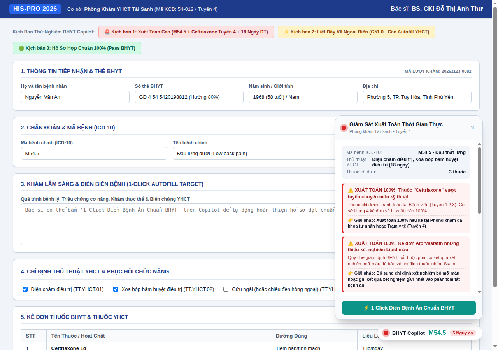
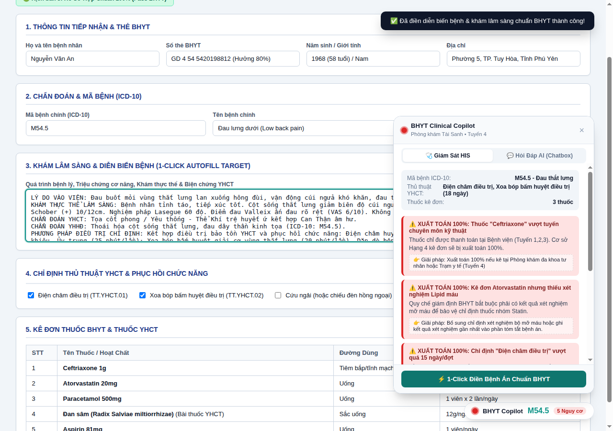
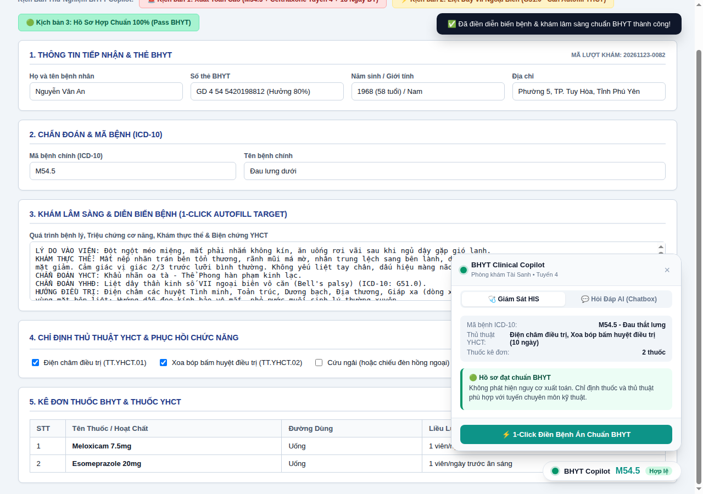
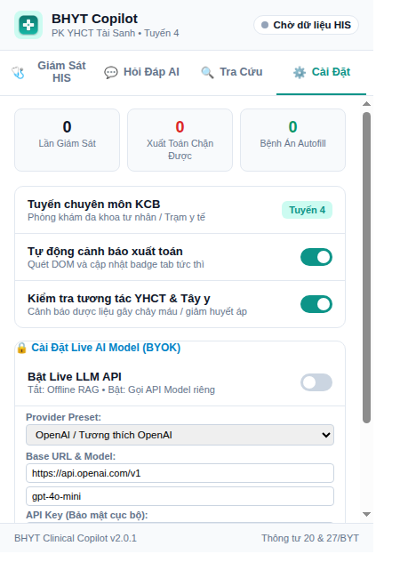

# Tái Sanh BHYT Clinical Copilot & Động Cơ Chống Xuất Toán BHYT

<p align="center">
  <strong>Trợ Lý AI Lâm Sàng Chuẩn Enterprise, Hệ Thống Giám Sát Chống Xuất Toán Thời Gian Thực & In-Browser Copilot Cho Y Tế Việt Nam</strong>
</p>

<p align="center">
  <a href="README.vi.md">🇻🇳 <strong>Tiếng Việt (Đang xem)</strong></a> &nbsp;|&nbsp; 
  <a href="README.md">🇬🇧 <strong>English (English Documentation)</strong></a>
</p>

<p align="center">
  
  
  
  
  
  
  
  
</p>

---

## 📑 Mục Lục

1. [Tổng Quan Sản Phẩm](#-tổng-quan-sản-phẩm)
2. [Nỗi Đau Thực Tế Của Bác Sĩ & Cơ Sở Y Tế](#-nỗi-đau-thực-tế-của-bác-sĩ--cơ-sở-y-tế)
3. [Kiến Trúc Hệ Thống 3 Tầng](#-kiến-trúc-hệ-thống-3-tầng)
4. [Minh Chứng Thực Tế & Ảnh Chụp Màn Hình](#-minh-chứng-thực-tế--ảnh-chụp-màn-hình)
5. [Các Phân Hệ Chức Năng Cốt Lõi](#-các-phân-hệ-chức-năng-cốt-lõi)
6. [Hướng Dẫn Kết Nối Model Context Protocol (MCP)](#-hướng-dẫn-kết-nối-model-context-protocol-mcp)
7. [Cài Đặt & Khởi Động Nhanh](#-cài-đặt--khởi-động-nhanh)
8. [Triển Khai Chrome Extension Manifest V3](#-triển-khai-chrome-extension-manifest-v3)
9. [Cẩm Nang Sử Dụng CLI](#-cẩm-nang-sử-dụng-cli)
10. [Tài Liệu REST API](#-tài-liệu-rest-api)
11. [Căn Cứ Pháp Lý & Danh Mục Dùng Chung Bộ Y Tế](#-căn-cứ-pháp-lý--danh-mục-dùng-chung-bộ-y-tế)
12. [Bộ Kiểm Thử Tự Động & Thẩm Định](#-bộ-kiểm-thử-tự-động--thẩm-định)
13. [Cấu Trúc Thư Mục Dự Án](#-cấu-trúc-thư-mục-dự-án)
14. [Đóng Góp & Bản Quyền](#-đóng-góp--bản-quyền)

---

## 🌟 Tổng Quan Sản Phẩm

**Tái Sanh BHYT Clinical Copilot** là hệ thống AI y tế chuyên sâu cấp Enterprise, được thiết kế chuyên biệt nhằm **triệt tiêu rủi ro xuất toán Bảo hiểm Y tế (Zero BHYT Rejection)**, kiểm soát **chuẩn hóa mã hóa lâm sàng**, bảo vệ **an toàn tương tác thuốc Đông – Tây y (YHCT & Tân dược)** và tự động điền **hồ sơ bệnh án điện tử 1-click** trực tiếp trên phần mềm quản lý bệnh viện/phòng khám (HIS/EMR) tại Việt Nam.

Khác với các ứng dụng ghi chép chung chung (Generic AI Voice Scribes) gặp rào cản pháp lý và bảo mật mạng bệnh viện nội bộ, Tái Sanh BHYT Copilot vận hành trực tiếp trong trình duyệt thông qua **Chrome Extension Manifest V3**, kết hợp cùng backend **FastAPI / Model Context Protocol (MCP)** và cơ sở dữ liệu tra cứu siêu tốc **SQLite FTS5** chứa đầy đủ **15.827 mã ICD-10 tiếng Việt**, danh mục thuốc tân dược (Thông tư 20/2022/TT-BYT), danh mục vị thuốc YHCT (Thông tư 27/2020/TT-BYT), định mức kỹ thuật (Thông tư 13/2019/TT-BYT) và hơn 22 quy tắc xuất toán kinh điển của BHXH Việt Nam.

```
   ┌────────────────────────────────────────────────────────────────────────┐
   │                     RADAR CẢNH BÁO XUẤT TOÁN BHYT TỨC THỜI             │
   │  [!] Lỗi Vượt Tuyến Kỹ Thuật: Ceftriaxone tiêm 1g cấm kê tại Tuyến 4.  │
   │  [!] Lỗi Thiếu Mã Chi Tiết: Nhóm M54 bắt buộc dùng mã 4 ký tự -> M54.5.│
   │  [!] Lỗi Thiếu Cận Lâm Sàng: Kê Statin (E78) thiếu bộ mỡ máu 90 ngày.  │
   │  [!] Cảnh Báo Nguy Hiểm: Đan sâm phối hợp Aspirin tăng nguy cơ xuất huyết.│
   │  [+] Khuyến Nghị Khắc Phục: Thay Meloxicam 7.5mg + Điện châm <= 15 ngày.│
   └────────────────────────────────────────────────────────────────────────┘
```

---

## 🩺 Nỗi Đau Thực Tế Của Bác Sĩ & Cơ Sở Y Tế

### 1. Nỗi Đau Xuất Toán BHYT Bằng Tiền Mặt (Zero BHYT Rejection)
Cơ quan Bảo hiểm Xã hội (BHXH) thực hiện giám định điện tử tự động 100% hồ sơ qua Cổng tiếp nhận dữ liệu Hệ thống thông tin giám định BHYT. Chỉ cần một sai sót nhỏ:
- Bác sĩ phòng khám tư nhân (Tuyến 4) kê kháng sinh tiêm thế hệ 3 (Ceftriaxone, Cefotaxime).
- Kê mã ICD-10 dạng 3 ký tự chung chung (`M54` thay vì bắt buộc dùng mã 4 ký tự `M54.5`).
- Kê thuốc hạ mỡ máu nhóm Statin (Atorvastatin, Rosuvastatin) nhưng bệnh án không có kết quả xét nghiệm Cholesterol/Triglyceride/LDL-C trong vòng 3–6 tháng.
- Chỉ định thủ thuật Điện châm, Xoa bóp bấm huyệt vượt trần 15 ngày liên tục trong một đợt ngoại trú.

Hậu quả là **toàn bộ chi phí thuốc, tiền khám và thủ thuật bị từ chối thanh toán (xuất toán 100%)**, dẫn đến phòng khám bị truy thu hoặc bác sĩ bị trừ lương trực tiếp. Tái Sanh Copilot phát hiện và chặn đứng mọi nguy cơ này **ngay khi bác sĩ đang gõ phím trên màn hình HIS**.

### 2. Vùng Trũng Nguy Hiểm: Tương Tác Thuốc Đông Y & Tây Y
Việt Nam là một trong số ít quốc gia có mạng lưới khám chữa bệnh kết hợp Đông – Tây y phát triển mạnh mẽ và được quỹ BHYT chi trả. Tuy nhiên, các mô hình AI y tế quốc tế hoàn toàn mù về Dược học cổ truyền Việt Nam:
- **Cam thảo (*Radix Glycyrrhizae*)**: Chứa hoạt chất *Glycyrrhizin* gây ức chế enzyme 11β-HSD2, làm giữ muối nước, đào thải Kali nghiêm trọng và vô hiệu hóa các thuốc hạ huyết áp (nhóm ACEI, ARB, chẹn Calci).
- **Đan sâm (*Salvia miltiorrhiza*) / Đương quy (*Angelica sinensis*)**: Có tính hoạt huyết mạnh, khi dùng đồng thời với thuốc chống đông Tây y (Aspirin, Clopidogrel, Warfarin, Xarelto) làm tăng vọt nguy cơ xuất huyết tiêu hóa và xuất huyết nội sọ.

Tái Sanh Copilot tích hợp sẵn ma trận đối chiếu tương tác Đông – Tây y tự động cảnh báo mức độ nghiêm trọng và gợi ý giải pháp thay thế an toàn.

### 3. Tích Hợp Không Xâm Lấn Phần Mềm HIS Đóng (Zero-API DOM Injection)
Các giải pháp phần mềm bệnh viện tại Việt Nam (VNPT-HIS, Viettel Solutions, Medisoft, FPT Healthcare) là hệ thống đóng, chu kỳ phê duyệt và cấp API thường kéo dài nhiều tháng đến cả năm. Tái Sanh Copilot giải quyết bài toán này triệt để bằng **In-Browser Content Script**, tự động bắt các sự kiện DOM trên giao diện web của HIS, đọc mã bệnh, đơn thuốc và **tự động điền mô tả khám lâm sàng chỉ với 1 cú nhấp chuột (1-Click Autofill)** mà không cần can thiệp vào mã nguồn backend của HIS.

### 4. Cơ Chế Tự Động Cập Nhật Danh Mục Dùng Chung Bộ Y Tế (Auto-Update Engine)
Các thông tư, danh mục dùng chung và quy chế đấu thầu BHYT thay đổi liên tục. Hệ thống tích hợp sẵn cơ chế Auto-Update Watchdog định kỳ rà soát checksum SHA-256 từ Cổng Dữ liệu Dùng chung Bộ Y tế, tự động đồng bộ delta vào SQLite database mà không làm gián đoạn các dịch vụ đang hoạt động.

---

## 🏛️ Kiến Trúc Hệ Thống 3 Tầng

Tái Sanh BHYT Clinical Copilot được xây dựng theo mô hình kiến trúc phân tầng chuyên biệt:

```
┌───────────────────────────────────────────────────────────────────────────────────────────────────┐
│                                 TẦNG TRÌNH DUYỆT (IN-BROWSER CLIENT)                              │
│                                                                                                   │
│   ┌───────────────────────────────────────────────────────────────────────────────────────────┐   │
│   │                         Giao Diện Cổng Thông Tin HIS Bệnh Viện / EMR                      │   │
│   │                 [ Ô Mã ICD-10 ]       [ Bảng Kê Đơn Thuốc ]      [ Chỉ Định Dịch Vụ ]     │   │
│   └──────────────────────┬─────────────────────────┬───────────────────────────┬──────────────┘   │
│                          │ Sự kiện gõ / thay đổi   │ Bắt DOM thời gian thực    │ 1-Click Điền     │
│                          ▼                         ▼                           ▲                  │
│   ┌────────────────────────────────────────────────────────────────────────────┴──────────────┐   │
│   │                   Chrome Extension Manifest V3 (Content Script & Dock Nổi)                 │   │
│   │  • Nút bấm trạng thái nổi (Hiển thị số vi phạm)    • Huy hiệu cảnh báo đỏ/vàng trên DOM   │   │
│   │  • Cơ chế 1-Click Autofill mô tả bệnh án SOAP      • Bảng Modal kiểm toán chi tiết        │   │
│   └──────────────────────┬─────────────────────────────────────────────────────┬──────────────┘   │
│                          │ Trao đổi message                                    │ Chrome Storage   │
│                          ▼                                                     ▼                  │
│   ┌──────────────────────────────────────────────────────┐   ┌────────────────────────────────┐   │
│   │            Extension Service Worker & Popup          │   │  Bộ Dữ Liệu Offline JSON       │   │
│   │  • Cache quy tắc cục bộ • Quản lý cảnh báo nền       │   │  15.827 ICD, Thuốc, Vị thuốc   │   │
│   └──────────────────────┬───────────────────────────────┘   └────────────────────────────────┘   │
└──────────────────────────┼────────────────────────────────────────────────────────────────────────┘
                           │ Giao thức REST / HTTP / JSON-RPC
                           ▼
┌───────────────────────────────────────────────────────────────────────────────────────────────────┐
│                                  TẦNG BACKEND & ĐỘNG CƠ MCP                                       │
│                                                                                                   │
│   ┌──────────────────────────────────────────────────────┐   ┌────────────────────────────────┐   │
│   │             FastAPI REST Server (:8123)              │   │        Stdio MCP Server        │   │
│   │  • POST /api/validate       • POST /api/suggest-note │   │  • Tools: validate_prescription│   │
│   │  • GET  /api/search-icd     • POST /api/chat (Hỏi đáp│   │  • Tools: search_icd10         │   │
│   │  • POST /api/sync-data      • GET  /api/health       │   │  • Tools: ask_clinical_copilot │   │
│   └──────────────────────┬───────────────────────────────┘   └────────────────┬───────────────┘   │
│                          │                                                    │                   │
│                          └───────────────────────┬────────────────────────────┘                   │
│                                                  ▼                                                │
│   ┌───────────────────────────────────────────────────────────────────────────────────────────┐   │
│   │                        Động Cơ Kiểm Toán BHYT Cốt Lõi (server.py)                         │   │
│   │  • Kiểm tra Phân tuyến Kỹ thuật (Tuyến 1-4)          • Rà soát Mã ICD 4 ký tự & Bệnh chính│   │
│   │  • Phát hiện Tương tác Dược liệu YHCT & Tây y        • Khống chế Trần Ngày Thủ thuật TT13 │   │
│   │  • Ma trận Cận lâm sàng Bắt buộc (Statin/Lipid)      • Khởi tạo Mô tả Khám Thực thể SOAP  │   │
│   └──────────────────────────────────────────────┬────────────────────────────────────────────┘   │
└──────────────────────────────────────────────────┼────────────────────────────────────────────────┘
                                                   │ Truy vấn CSDL SQLite & FTS5
                                                   ▼
┌───────────────────────────────────────────────────────────────────────────────────────────────────┐
│                                 TẦNG DỮ LIỆU & TỰ ĐỘNG ĐỒNG BỘ                                    │
│                                                                                                   │
│   ┌───────────────────────────────────────────────────────────────────────────────────────────┐   │
│   │                   Cơ Sở Dữ Liệu Danh Mục BHYT (data/bhyt_catalog.db)                      │   │
│   │  • icd10 (15.827 mã + Chỉ mục tìm kiếm FTS5)         • thuoc_bhyt (Danh mục thuốc TT20)   │   │
│   │  • thuoc_yhct (Vị thuốc TT27 & Cảnh báo tương tác)   • thu_thuat_bhyt (Định mức TT13)     │   │
│   │  • xuat_toan_rules (22 quy tắc xuất toán chuẩn)      • yhct_icd10_mapping (QĐ 4443 Ánh xạ)│   │
│   └──────────────────────────────────────────────▲────────────────────────────────────────────┘   │
│                                                  │ Đồng bộ Delta & Xác thực Checksum              │
│   ┌──────────────────────────────────────────────┴────────────────────────────────────────────┐   │
│   │                  Động Cơ Tự Động Cập Nhật Danh Mục (data_engine/updater.py)               │   │
│   │  • Kiểm tra toàn vẹn Checksum SHA-256                • Sao lưu dự phòng Snapshot tự động  │   │
│   │  • Thu thập dữ liệu Cổng Dùng chung Bộ Y tế / BHXH   • Lập lịch Cron tự động định kỳ      │   │
│   └───────────────────────────────────────────────────────────────────────────────────────────┘   │
└───────────────────────────────────────────────────────────────────────────────────────────────────┘
```

---

## 📸 Minh Chứng Thực Tế & Ảnh Chụp Màn Hình

### 1. Bảng Kiểm Toán Xuất Toán Nổi Trực Tiếp Trên Phần Mềm HIS
*Phát hiện đồng thời lỗi kê kháng sinh tiêm Ceftriaxone 1g vượt tuyến 4, mã ICD-10 M54 thiếu ký tự chi tiết, thủ thuật vượt trần 15 ngày và tương tác nguy hiểm giữa Đan sâm với thuốc chống đông:*



---

### 2. 1-Click Tự Động Điền Bệnh Án & Khám Thực Thể Chuẩn Hóa
*Sinh tự động lý do vào viện, triệu chứng cơ năng, khám thực thể lâm sàng, chẩn đoán YHCT & YHHĐ và chỉ định điều trị phù hợp vào textarea của HIS:*



---

### 3. Hồ Sơ Tuân Thủ An Toàn Tuyệt Đối (Zero Xuất Toán)
*Sau khi điều chỉnh đơn thuốc và thủ thuật đúng quy chế BHYT tuyến phòng khám, hệ thống chuyển sang trạng thái xanh an toàn 100%:*



---

### 4. Giao Diện Popup Extension & Tra Cứu Danh Mục Offline
*Tìm kiếm FTS5 siêu tốc không dấu và có dấu trên 15.827 mã ICD-10, thuốc tân dược và dược liệu YHCT kèm cờ quy chế BHYT:*



---

## ⚡ Các Phân Hệ Chức Năng Cốt Lõi

| Phân Hệ | Đường Dẫn | Chức Năng Chính |
| :--- | :--- | :--- |
| **Động Cơ Kiểm Toán BHYT** | `mcp_server/server.py` | Thực thi 22+ quy tắc giám định điện tử, phân tuyến kỹ thuật, trần ngày thủ thuật, điều kiện cận lâm sàng. |
| **Trợ Lý Hỏi Đáp Lâm Sàng** | `mcp_server/server.py` | Hệ thống RAG chuyên sâu giải đáp thắc mắc của bác sĩ về quy chế kê đơn, căn cứ pháp lý và dược lý lâm sàng. |
| **Máy Chủ REST API** | `mcp_server/api.py` | Cung cấp dịch vụ API hiệu năng cao cho Chrome Extension và các hệ thống bệnh viện bên thứ ba. |
| **Máy Chủ Stdio MCP** | `mcp_server/mcp_stdio.py` | Chuẩn hóa giao thức Model Context Protocol cho Claude Desktop, Cursor AI và Hermes Agent. |
| **Chrome Extension V3** | `extension/` | Giao diện nhúng trực tiếp vào HIS, bảng dock nổi, bắt sự kiện DOM và bộ dữ liệu offline dự phòng. |
| **CSDL Danh Mục SQLite** | `data/bhyt_catalog.db` | CSDL chuẩn hóa 15.827 mã ICD-10, bảng ảo FTS5, danh mục thuốc TT20 và dược liệu TT27. |
| **Công Cụ Quản Trị CLI** | `data_engine/cli.py` | Quản trị viên tra cứu nhanh, kiểm thử đơn thuốc và theo dõi trạng thái CSDL trong terminal. |
| **Động Cơ Auto-Update** | `data_engine/updater.py` | Tự động kiểm tra bản cập nhật mới từ Bộ Y tế, xác thực SHA-256 và di chuyển dữ liệu nguyên tử (atomic). |

---

## 🤖 Hướng Dẫn Kết Nối Model Context Protocol (MCP)

Tái Sanh BHYT Copilot triển khai đầy đủ đặc tả kỹ thuật **Model Context Protocol (MCP)** (phiên bản chuẩn `2024-11-05`), cho phép các mô hình ngôn ngữ lớn (Claude Code, Claude Desktop, Cursor AI, Hermes Agent) trực tiếp gọi các công cụ kiểm toán và tra cứu y tế chuẩn hóa.

### 1. Cấu Hình Cho Claude Desktop
Thêm định nghĩa máy chủ vào tệp tin `claude_desktop_config.json`:

- **macOS**: `~/Library/Application Support/Claude/claude_desktop_config.json`
- **Windows**: `%APPDATA%\Claude\claude_desktop_config.json`
- **Linux**: `~/.config/Claude/claude_desktop_config.json`

```json
{
  "mcpServers": {
    "taisan-bhyt-copilot": {
      "command": "python3",
      "args": ["-m", "mcp_server.mcp_stdio"],
      "cwd": "/root/taisan-bhyt-copilot"
    }
  }
}
```

### 2. Cấu Hình Cho Cursor IDE
Trong thư mục dự án hoặc cấu hình toàn cục, chỉnh sửa `.cursor/mcp.json`:

```json
{
  "mcpServers": {
    "bhyt-copilot": {
      "command": "python3",
      "args": ["/root/taisan-bhyt-copilot/mcp_server/mcp_stdio.py"]
    }
  }
}
```

### 3. Chi Tiết Danh Mục Công Cụ MCP (Tools Manifest)

#### `validate_prescription`
Thẩm định đơn thuốc và chỉ định dịch vụ kỹ thuật theo quy chế giám định BHYT Việt Nam.
- **Tham số đầu vào**:
  - `icd_code` *(chuỗi, bắt buộc)*: Mã bệnh chính ICD-10 (VD: `"M54.5"`, `"E11.9"`, `"I10"`).
  - `drugs` *(mảng chuỗi)*: Danh sách thuốc kê đơn kèm hàm lượng (VD: `["Ceftriaxone 1g", "Paracetamol 500mg"]`).
  - `hospital_level` *(chuỗi, mặc định "4")*: Tuyến chuyên môn kỹ thuật (`"1"`: Tuyến Trung ương, `"2"`: Tuyến Tỉnh, `"3"`: Tuyến Huyện, `"4"`: Phòng khám đa khoa tư nhân / Trạm y tế).
  - `procedures` *(mảng chuỗi)*: Danh mục thủ thuật chỉ định (VD: `["Điện châm điều trị"]`).
  - `lab_tests` *(mảng chuỗi)*: Các xét nghiệm cận lâm sàng đã có (VD: `["Lipid máu", "Glucose"]`).
  - `procedure_days` *(số nguyên, mặc định 1)*: Số ngày thực hiện thủ thuật trong một đợt.
- **Kết quả trả về**: Payload JSON gồm trạng thái `status` (`PASS`, `FAIL_RISK`, `REJECT`), số lỗi nghiêm trọng `high_risk_count`, chi tiết từng cảnh báo và phương án khắc phục cụ thể.

#### `search_icd10`
Tra cứu toàn văn siêu tốc (FTS5) trong kho 15.827 mã ICD-10 Bộ Y tế.
- **Tham số đầu vào**: `keyword` *(chuỗi)*, `limit` *(số nguyên, mặc định 10)*.
- **Kết quả trả về**: Danh sách mã ICD kèm tên tiếng Việt, tên tiếng Anh, tên chương và cờ quy chế (`must_use_subcode`, `not_allowed_primary`).

#### `check_herb_drug_interaction`
Kiểm tra cảnh báo tương tác chéo giữa Dược liệu Y học Cổ truyền và Thuốc Tân dược Tây y.
- **Tham số đầu vào**: `tcm_herbs` *(mảng chuỗi)*, `western_drugs` *(mảng chuỗi)*.
- **Kết quả trả về**: Cảnh báo cơ chế tương tác, nguy cơ lâm sàng và khuyến nghị điều chỉnh liều/thay thế vị thuốc.

#### `suggest_clinical_note`
Tự động khởi tạo mô tả khám bệnh lâm sàng thực thể, triệu chứng cơ năng và chẩn đoán YHCT/YHHĐ chuẩn SOAP.
- **Tham số đầu vào**: `icd_code` *(chuỗi)*, `procedures` *(mảng chuỗi)*, `symptoms` *(chuỗi tuỳ chọn)*.
- **Kết quả trả về**: Bản mô tả lâm sàng hoàn chỉnh sẵn sàng điền vào phần mềm HIS.

#### `ask_clinical_copilot`
Trợ lý AI hỏi đáp quy chế BHYT, phân tuyến kê đơn thuốc, định mức thủ thuật và dược lý lâm sàng thời gian thực.
- **Tham số đầu vào**: `query` *(chuỗi câu hỏi)*, `hospital_level` *(chuỗi, mặc định "4")*.
- **Kết quả trả về**: Câu trả lời chi tiết, trích dẫn số thông tư pháp lý và đoạn văn bản gợi ý cho bệnh án.

---

## 🚀 Cài Đặt & Khởi Động Nhanh

### 1. Yêu Cầu Môi Trường
- Hệ điều hành: Linux, macOS hoặc Windows WSL2.
- Python `>= 3.10`
- SQLite `>= 3.35` (có hỗ trợ FTS5)
- Trình duyệt Chrome / Edge / Brave (cho Extension)

### 2. Tải Mã Nguồn & Thiết Lập
```bash
# Clone kho mã nguồn
git clone https://github.com/phongkhamtaisanh/taisan-bhyt-copilot.git
cd taisan-bhyt-copilot

# Tạo và kích hoạt môi trường ảo (khuyến nghị)
python3 -m venv .venv
source .venv/bin/activate

# Cài đặt thư viện phụ thuộc
pip install -r requirements.txt
```

### 3. Kiểm Tra CSDL Danh Mục BHYT
```bash
# Kiểm tra trạng thái dữ liệu trong CSDL SQLite
python3 data_engine/cli.py status
```
*Kết quả hiển thị mẫu:*
```
======================================================================
  TAI SANH BHYT CLINICAL COPILOT & XUẤT TOÁN VALIDATOR
======================================================================
Database Location : /root/taisan-bhyt-copilot/data/bhyt_catalog.db
Metadata Version  : 1.0.0
Last Synchronized : 2026-11-23T20:41:26
Sync Checksum     : 7a9e403d1fb...

--- RECORD COUNTS ---
• ICD-10 Disease Codes      : 15,827
• BHYT Western Drugs (TT20) : 378
• TCM Herbs & Formulas (TT27): 210
• BHYT Procedures (TT13)    : 10
• Core Xuat Toan Rules      : 22
======================================================================
```

### 4. Khởi Chạy Dịch Vụ
```bash
# Khởi chạy FastAPI REST API (Phục vụ Chrome Extension và Webhook)
python3 -m uvicorn mcp_server.api:app --host 127.0.0.1 --port 8123

# Trong terminal khác: Kiểm tra máy chủ Stdio MCP
python3 -m mcp_server.mcp_stdio
```

---

## 🧩 Triển Khai Chrome Extension Manifest V3

Tiện ích mở rộng tương thích với tất cả các trình duyệt Chromium (Google Chrome, Microsoft Edge, Brave, Cốc Cốc):

1. Mở trình duyệt và truy cập vào địa chỉ: `chrome://extensions/`
2. Bật công tắc **Developer mode (Chế độ dành cho nhà phát triển)** ở góc trên bên phải.
3. Bấm nút **Load unpacked (Tải tiện ích đã giải nén)** ở góc trên bên trái.
4. Chọn thư mục `extension/` của dự án:
   ```
   /root/taisan-bhyt-copilot/extension
   ```
5. Ghim biểu tượng **BHYT Copilot** lên thanh công cụ trình duyệt.
6. Mở phần mềm quản lý bệnh viện nội bộ hoặc kiểm thử trực tiếp trên cổng giả lập offline:
   ```bash
   # Mở trang thử nghiệm offline trong trình duyệt:
   file:///root/taisan-bhyt-copilot/extension/test_bed.html
   ```

---

## 💻 Cẩm Nang Sử Dụng CLI

Công cụ CLI tích hợp cho phép nhân viên y tế và kỹ thuật viên thao tác trực tiếp trong dòng lệnh:

```bash
# 1. Tra cứu mã bệnh ICD-10 toàn văn (tiếng Việt có dấu và không dấu)
python3 data_engine/cli.py search icd "thoát vị đĩa đệm"

# 2. Tra cứu hoạt chất tân dược và phân tuyến kỹ thuật được phép kê
python3 data_engine/cli.py search drug "ceftriaxone"

# 3. Tra cứu vị thuốc YHCT và cảnh báo tương tác chéo
python3 data_engine/cli.py search herb "đan sâm"

# 4. Kiểm toán đơn thuốc và thủ thuật trực tiếp
python3 data_engine/cli.py audit \
  --icd M54.5 \
  --drugs "Paracetamol 500mg, Ceftriaxone 1g" \
  --procedures "Điện châm điều trị" \
  --days 18 \
  --level 4

# 5. Kiểm tra cập nhật danh mục Bộ Y tế tự động
python3 scripts/auto_update_cron.py

# 6. Cưỡng bức đồng bộ lại toàn bộ dữ liệu & tạo bản backup snapshot
python3 scripts/auto_update_cron.py --force
```

---

## 📡 Tài Liệu REST API

Khi máy chủ FastAPI đang chạy (`http://127.0.0.1:8123`), tài liệu tương tác Swagger UI luôn sẵn sàng tại `http://127.0.0.1:8123/docs`.

### Danh Sách Endpoints Tiêu Biểu:
- `POST /api/validate`: Tiếp nhận đơn thuốc và dịch vụ kỹ thuật để đối soát 22+ quy tắc xuất toán.
- `GET /api/search-icd?q={từ_khóa}&limit=10`: Tìm kiếm FTS5 trên 15.827 mã ICD-10.
- `POST /api/suggest-note`: Sinh đoạn mô tả lâm sàng SOAP chuẩn bảo vệ chỉ định BHYT.
- `POST /api/chat`: Trợ lý AI hỏi đáp trực tiếp các thắc mắc chuyên môn và pháp lý của bác sĩ.
- `POST /api/sync-data`: Kích hoạt tiến trình chạy ngầm đồng bộ danh mục Bộ Y tế mới nhất.
- `GET /api/health`: Kiểm tra tình trạng kết nối và mã băm toàn vẹn CSDL.

---

## ⚖️ Căn Cứ Pháp Lý & Danh Mục Dùng Chung Bộ Y Tế

Toàn bộ logic giám định và danh mục dữ liệu của hệ thống được xây dựng bám sát 100% các văn bản quy phạm pháp luật hiện hành:

| Văn Bản Pháp Quy | Cơ Quan Ban Hành | Phạm Vi Áp Dụng Trong Copilot |
| :--- | :--- | :--- |
| **Thông tư 20/2022/TT-BYT** | Bộ Y Tế | Danh mục thuốc tân dược đấu thầu BHYT, phân hạng bệnh viện được phép kê (Tuyến 1-4), điều kiện thanh toán và tỷ lệ BHYT chi trả. |
| **Thông tư 27/2020/TT-BYT** | Bộ Y Tế | Danh mục vị thuốc YHCT và thuốc dược liệu thanh toán BHYT; chống chỉ định tương tác chéo. |
| **Thông tư 13/2019/TT-BYT** | Bộ Y Tế | Định mức kinh tế kỹ thuật dịch vụ khám chữa bệnh (Khống chế số ngày điều trị thủ thuật ngoại trú $\le 15$ ngày/đợt). |
| **Quyết định 7603/QĐ-BYT** | Bộ Y Tế | Bộ mã danh mục dùng chung phục vụ giám định BHYT điện tử; bắt buộc dùng mã ICD 4 ký tự chi tiết (`MUST_USE_SUBCODE`). |
| **Quyết định 4443/QĐ-BYT** | Bộ Y Tế | Bảng ánh xạ danh mục chứng trạng Y học Cổ truyền sang mã bệnh ICD-10 tương ứng. |

---

## 🧪 Bộ Kiểm Thử Tự Động & Thẩm Định

Dự án sở hữu bộ kiểm thử tự động toàn diện bao gồm Unit Tests, Integration Tests, Stdio MCP Tests và Playwright Headless Browser E2E Tests:

```bash
# Chạy toàn bộ 35 ca kiểm thử tự động (100% PASS)
python3 -m unittest discover -s tests
```

*Trích xuất nhật ký thực thi thực tế:*
```
Ran 35 tests in 5.806s
OK
Verified schema & FTS5 search: 5 ICD rows matched 'khớp', 5 drug rows matched 'paracetamol'.
ICD-10 sync verified: 15,827 records successfully in DB.
Xuat Toan Rules sync verified: 22 rules in DB.
Thuoc TT20 sync verified: 378 drugs in DB, tier restrictions intact.
Full sync verified: {'icd10': 15827, 'thuoc_bhyt': 378, 'thu_thuat_bhyt': 10, 'thuoc_yhct': 200, ...}
```

```bash
# Chạy kiểm thử E2E trình duyệt Chrome Extension với Playwright
node tests/run_e2e_suite.js
node tests/test_popup_e2e.js
```

---

## 📂 Cấu Trúc Thư Mục Dự Án

```
taisan-bhyt-copilot/
├── data/
│   ├── bhyt_catalog.db            # CSDL SQLite chính (15.827 mã ICD, Bảng ảo FTS5)
│   ├── sync_metadata.json         # Checksum SHA-256, mốc thời gian và phiên bản CSDL
│   └── raw/                       # Tập dữ liệu thô tải từ Bộ Y tế / WHO
├── data_engine/
│   ├── db.py                      # Kết nối SQLite, chỉ mục tìm kiếm FTS5 & migration
│   ├── icd10_sync.py              # Xử lý & chuẩn hóa 15.827 mã ICD-10 tiếng Việt
│   ├── thuoc_tt20_sync.py         # Danh mục thuốc tân dược Thông tư 20/2022/TT-BYT
│   ├── thu_thuat_tt13_sync.py     # Danh mục định mức thủ thuật Thông tư 13/2019/TT-BYT
│   ├── yhct_tt27_sync.py          # Danh mục vị thuốc YHCT Thông tư 27/2020 & Ma trận tương tác
│   ├── xuat_toan_rules_sync.py    # 22 quy tắc xuất toán kinh điển của BHXH
│   ├── updater.py                 # Động cơ tự động cập nhật, sao lưu snapshot & xác thực hash
│   └── cli.py                     # Giao diện dòng lệnh CLI tra cứu và kiểm toán
├── mcp_server/
│   ├── server.py                  # Động cơ cốt lõi: Thẩm định quy tắc, Sinh bệnh án, Hỏi đáp RAG
│   ├── mcp_stdio.py               # Máy chủ Stdio MCP chuẩn JSON-RPC 2.0 (Claude/Cursor)
│   └── api.py                     # Máy chủ REST API FastAPI hiệu năng cao
├── extension/                     # Tiện ích mở rộng Chrome Extension Manifest V3
│   ├── manifest.json              # Cấu hình tiện ích Manifest V3
│   ├── popup/                     # Giao diện tra cứu, cài đặt & thống kê hồ sơ
│   ├── content/                   # Content scripts tiêm vào DOM phần mềm HIS
│   ├── background/                # Service worker chạy ngầm & bộ lập lịch dọn cache
│   ├── icons/                     # Bộ biểu tượng (16, 48, 128 px)
│   ├── data/catalog.json          # Danh mục offline dự phòng cho cơ sở không có mạng
│   └── test_bed.html              # Cổng thông tin HIS giả lập phục vụ kiểm thử E2E
├── test_artifacts/                # Ảnh chụp màn hình thẩm định thực tế
│   ├── 01_his_audit_card_open.png
│   ├── 02_clinical_note_autofilled.png
│   ├── 03_clean_compliant_record.png
│   └── 04_popup_ui_search_verified.png
├── scripts/
│   ├── auto_update_cron.py        # Kịch bản kiểm tra cập nhật lập lịch qua cron
│   ├── build_extension.py         # Kịch bản đóng gói tiện ích (.crx & .zip)
│   └── run_hermes_verify.py       # Bộ điều phối kiểm định tự động Hermes
└── tests/
    ├── test_db_init.py            # Kiểm thử Schema & FTS5 Virtual Tables
    ├── test_icd10_sync.py         # Kiểm thử toàn vẹn 15.827 mã ICD-10
    ├── test_thuoc_sync.py         # Kiểm thử danh mục thuốc TT20 & phân tuyến bệnh viện
    ├── test_thuthuat_sync.py      # Kiểm thử thủ thuật TT13 & định mức ngày điều trị
    ├── test_yhct_sync.py          # Kiểm thử dược liệu YHCT TT27 & tương tác Tây y
    ├── test_rules_sync.py         # Kiểm thử 22 quy tắc xuất toán BHYT
    ├── test_updater.py            # Kiểm thử Auto-Update, Backup & Metadata Checksum
    ├── test_data_engine.py        # Kiểm thử tích hợp toàn diện Data Engine
    ├── test_audit_engine.py       # Kiểm thử 8 ca xuất toán kinh điển (100% Pass)
    ├── test_chatbox.py            # Kiểm thử phân hệ hỏi đáp lâm sàng RAG
    └── test_mcp_stdio.py          # Kiểm thử giao thức chuẩn Stdio MCP
```

---

## 🤝 Đóng Góp & Bản Quyền

### Tác Giả & Cố Vấn Chuyên Môn
- **Biện Ngọc Tam (William)** — Kiến trúc sư trưởng & Kỹ sư thực thi kỹ thuật (`admin@phongkhamtaisanh.com`)
- **Phòng Khám YHCT Tài Sanh** — Cố vấn chuyên môn lâm sàng & Thẩm định quy chế BHYT (Tuy Hòa, Phú Yên, Việt Nam).

### Giấy Phép
Dự án được phân phối dưới giấy phép **MIT License**. Cấu trúc dữ liệu y tế tuân thủ các quy chuẩn Dữ liệu Mở của Bộ Y Tế Việt Nam.
